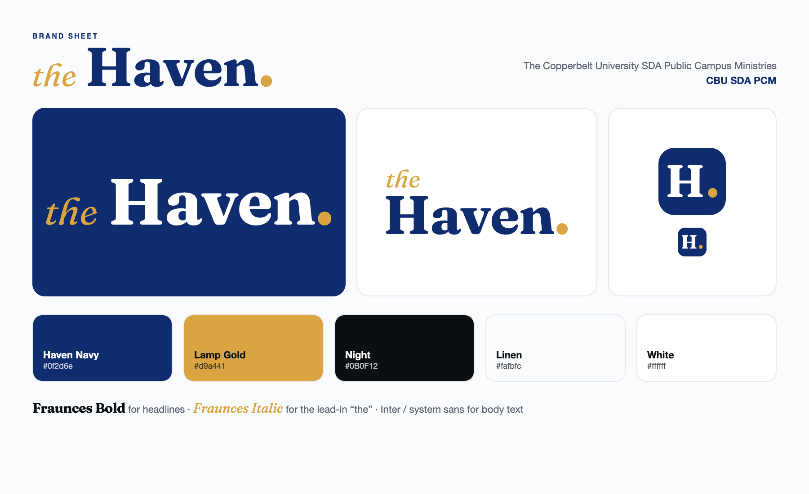

# The Haven — Brand Kit

The Haven is a Christ-centred campus ministry of **The Copperbelt University SDA Public Campus Ministries (CBU SDA PCM)**. The identity is about **shelter and light**: a safe place to belong, and the light of God's Word in it.

Everything here is generated from the brand fonts by `npm run brand` (`scripts/brand/build.mjs`). Change the script, not the files. It also refreshes the website favicon, the website and app posters, and the app icon and splash.

## Logo

The logo is **text only**: a gold italic *the*, **Haven** in Fraunces Bold, and a gold full stop. The full stop is the light.

| File (`logo/svg`, `logo/png`) | Use it for |
|---|---|
| `the-haven-navy` / `-white` | **Primary.** Website and app headers, letterheads, merch |
| `the-haven-stacked-navy` / `-white` | Square-ish spaces: posters, splash screens, social posts |
| `the-haven-monogram-navy` / `-white` | **H.**: very small sizes, watermarks, embroidery |

SVGs have transparent backgrounds and outlined letters, so they look the same everywhere. PNGs sit on a solid background for quick use.

| Folder | What it is |
|---|---|
| `app-icon/` | 1024 px app icon (white **H.** on navy) and the Android adaptive foreground |
| `splash/` | App splash artwork (stacked logo, PCM shield and CBU SDA PCM, for a navy background) |
| `posters/` | Five 1080×1350 posters: Welcome, Sabbath Worship, Bible Study, Need prayer?, Get the app |
| `pcm/` | The CBU SDA PCM shield (official, unchanged) |
| `fonts/` | Fraunces Bold and Italic (SIL Open Font License) |

## Colour

| Name | Hex | Role |
|---|---|---|
| Haven Navy | `#0f2d6e` | Primary colour: headers, buttons, logo |
| Lamp Gold | `#d9a441` | Accent only: *the*, the full stop, highlights. Never for body text. |
| Night | `#0B0F12` | Dark backgrounds and body text |
| Linen | `#fafbfc` | Page background |
| White | `#ffffff` | Cards, and text on navy or night |

## Typography

- **Headlines:** Fraunces Bold, with Fraunces Italic for a short lead-in word (like *the*).
- **Body and UI:** Inter on the web; the system sans-serif (SF Pro, Roboto) in the app.

## Naming

- In full: **The Copperbelt University SDA Public Campus Ministries**
- Short: **CBU SDA PCM**

## Do / Don't

- ✅ Leave clear space around the logo at least the height of the "H".
- ✅ Use the white logo on Navy or Night, and the navy logo on Linen or White.
- ❌ Don't recolour *the* or the full stop, stretch the logo, or set it in another typeface.
- ❌ Don't put the logo on busy photos without a navy overlay.
